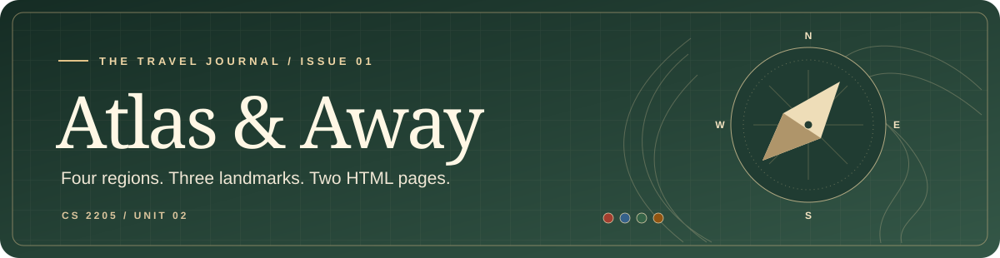
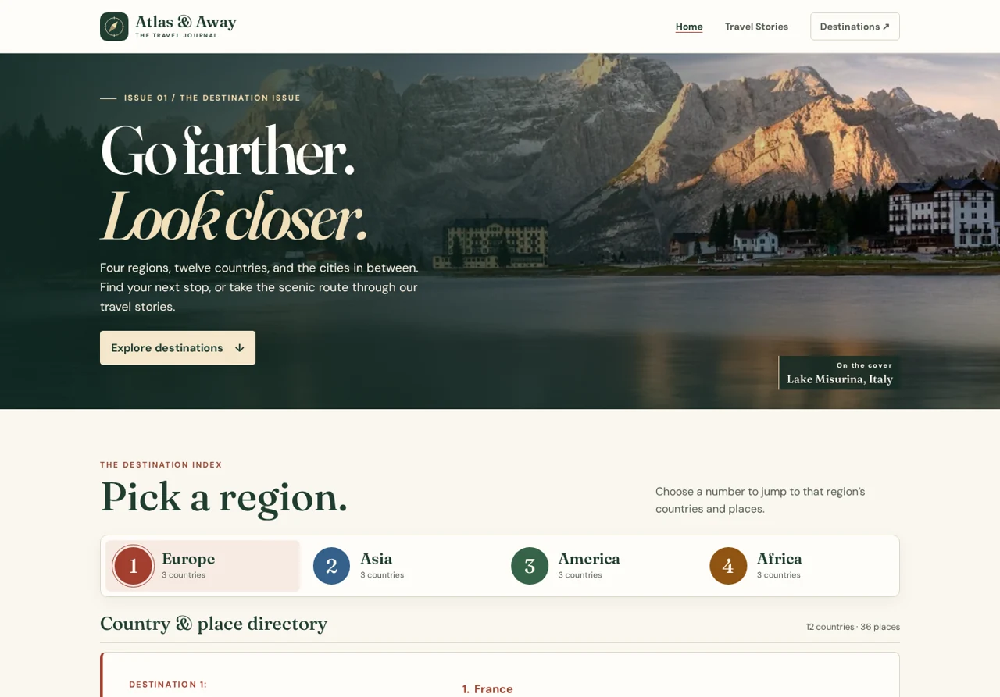
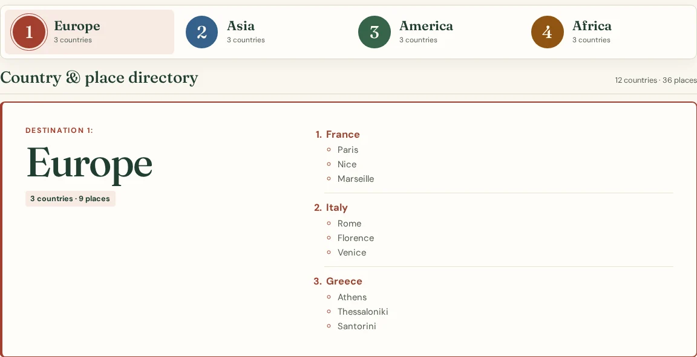
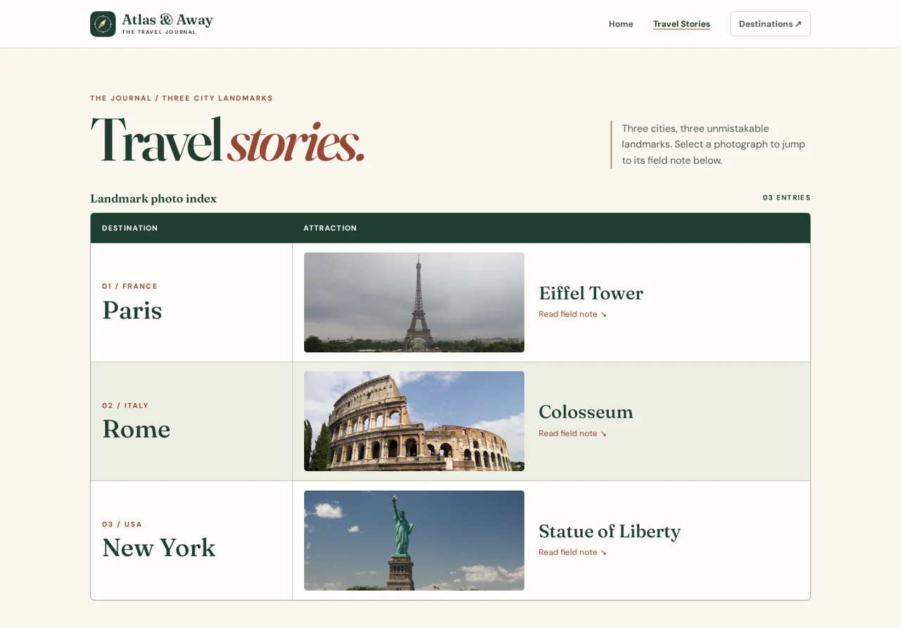
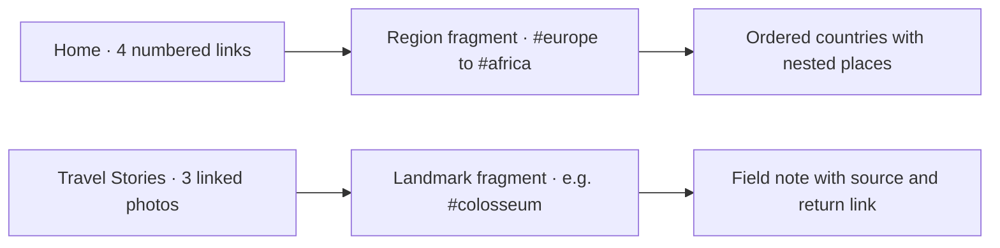

<p align="center">
  
</p>

<p align="center">
  <a href="#architecture"></a>
  <a href="#verification"></a>
  <a href="#publish"></a>
</p>

<p align="center">
  <a href="#tour">Tour</a> · <a href="#quick-start">Quick start</a> ·
  <a href="#architecture">Architecture</a> · <a href="#publish">Publish</a> ·
  <a href="#verification">Verification</a> · <a href="#credits">Credits</a>
</p>

**Atlas & Away** is a static travel journal built for **CS 2205 · Unit 2**. The homepage follows the assignment’s numbered region selector and nested lists. Travel Stories pairs three destinations with locally stored landmark photographs and short, linked field notes. Both pages use embedded CSS and work without JavaScript, a framework, or an API key.

## Tour

<a href="docs/readme/home.webp"></a>

| 01 · Destination directory | 02 · Travel Stories |
| :--- | :--- |
| [](docs/readme/directory.webp) | [](docs/readme/stories.webp) |
| Select a number to reveal its directory. **1** opens **Destination 1: Europe**. | Select a photo to jump to its field note. The picture fades on hover; the label remains fully legible. |
| [View home source →](index.html) | [View stories source →](travel-stories.html) |

The screenshots show the implemented site, not mockups. Open either image to inspect it at full size.

<details>
<summary><strong>How the site follows the assignment examples</strong></summary>

| Number | Region | Ordered countries |
| :---: | :--- | :--- |
| **1** · red | Europe | France, Italy, Greece |
| **2** · blue | Asia | Japan, China, India |
| **3** · green | America | USA, Brazil, Canada |
| **4** · amber | Africa | South Africa, Egypt, Morocco |

France lists **Paris, Nice, Marseille**; Italy lists **Rome, Florence, Venice**; and Greece lists **Athens, Thessaloniki, Santorini**. Every country has its own nested bulleted list. The second page preserves the reference’s two-column table: **Destination** on the left and **Attraction** on the right, with matching entries for Paris, Rome, and New York.

</details>

## Quick start

1. Extract the submission ZIP and keep the `Atlas-and-Away/` folder intact.
2. Open `index.html` in a browser. There is no install or compile step. Local photos and page links work offline; links to official landmark information require an internet connection.
3. To edit, open either HTML file in a plain-text editor and save as UTF-8. Styles are inside each file’s `<style>` block.

For an HTTP preview, run this **from the website folder** and open <http://127.0.0.1:8000/>:

```bash
python3 -m http.server 8000 --bind 127.0.0.1
```

On Windows, `py -m http.server 8000 --bind 127.0.0.1` is an alternative if `python3` is not recognized.

## Architecture



- **URLs are the state.** Native anchors use real `href` values and focusable targets. `:target` marks the current section; where `:has()` is supported, CSS shows only the selected region and defaults to Europe. If that enhancement is unavailable, all four directories remain visible and the anchors still work.
- **Structure comes before style.** Ordered country lists contain unordered place lists. The landmark table keeps its caption and scoped headers on desktop and phone layouts.
- **Color is a cue, not a requirement.** The controls retain their numbers and names. Focus outlines and text labels remain visible, and `prefers-reduced-motion` removes the movement without removing navigation.
- **Page loads use local assets.** WebP photographs and WOFF2 fonts are bundled. There are no analytics or third-party requests on page load.

<details>
<summary><strong>Repository map</strong></summary>

```text
Atlas-and-Away/
├── index.html                       # Region selector and nested directory
├── travel-stories.html              # Photo table and linked field notes
├── assets/                          # Site photos, fonts, and compass mark
├── README.md                        # Tour, setup, architecture, and credits
├── docs/readme/                     # Banner, badges, and browser screenshots
├── tools/check_site.py               # Standard-library structure and link checks
├── .github/workflows/site-checks.yml # Runs the checker on pushes and pull requests
└── vercel.json                       # Static deployment settings
```

</details>

## Publish

Push **only the website folder’s contents** to a GitHub repository. The Word report and evidence folder belong in the course submission, not in the public site repository.

<details>
<summary><strong>Push from the command line</strong></summary>

Create an empty GitHub repository first. Run these commands inside `Atlas-and-Away/` and replace the example remote URL with your repository URL:

```bash
git init -b main
git add .
git commit -m "Build Atlas & Away travel journal"
git remote add origin https://github.com/YOUR-USERNAME/YOUR-REPOSITORY.git
git push -u origin main
```

You can also upload the folder contents using GitHub’s web interface. Keep the relative paths intact.

</details>

In Vercel, choose **Add New → Project**, then import the repository. Use these settings, which match the included [`vercel.json`](vercel.json):

| Setting | Value |
| :--- | :--- |
| Root Directory | Repository root, or `Atlas-and-Away` if you kept it as a subfolder |
| Framework Preset | **Other** |
| Build Command | **Empty**; the files are served as-is |
| Output Directory | `.` |
| Environment variables | None |

After deployment, check the homepage, `/#africa`, and `/travel-stories.html#colosseum` on the production URL that Vercel assigns. The repository is prepared for deployment; it does not claim an existing production URL. See Vercel’s [GitHub import guide](https://vercel.com/docs/git/vercel-for-github) and [static build settings](https://vercel.com/docs/builds/configure-a-build#skip-build-step).

## Verification

| Check | Result on the included source |
| :--- | :--- |
| Nu Html Checker | **0 errors and 0 warnings** across the two HTML files |
| Region links | **4/4** open the correct panel; the exact 12 countries and 36 places are checked |
| Landmark links | **3/3** open the expected field note; all three images load and fade on hover |
| Browser and phone layouts | Fragment navigation exercised in Chromium and Firefox; widths of **320, 390, and 1,440 px** checked for overflow in Chromium |
| Keyboard and reduced motion | Keyboard focus and Enter activation checked; reduced-motion preferences suppress animated movement |

Run the repository’s markup and link checker from the website folder:

```bash
python3 tools/check_site.py
```

The [GitHub Actions workflow](.github/workflows/site-checks.yml) runs that same dependency-free command when the site is pushed. It protects the assignment’s data and structure; it does **not** replace the separate browser and Nu checks. If you adapt the site after the course, update the checker’s reference data along with any intentional changes to the country lists.

<details>
<summary><strong>Assignment rubric map</strong></summary>

| Criterion | Points | Where to look |
| :--- | ---: | :--- |
| Homepage HTML | 20 | [`index.html`](index.html) · four numbered fragment links and nested country/place lists |
| Travel Stories HTML | 25 | [`travel-stories.html`](travel-stories.html) · destination table and three linked landmark articles |
| Homepage CSS | 20 | `index.html` → embedded `<style>` · four distinct colors, hover/focus styles, and type hierarchy |
| Travel Stories CSS | 25 | `travel-stories.html` → embedded `<style>` · image opacity transition and styled table |
| Sources and evidence | 10 | [Credits](#credits), plus the APA references, annotated source, and screenshots in the separate Word report |

</details>

## Credits

### Course and landmark sources

- Dorman, M. (2020). *Introduction to web mapping*. CRC Press. <https://web-mapping.surge.sh/>
- MDN Web Docs. [Structuring documents](https://developer.mozilla.org/en-US/docs/Learn_web_development/Core/Structuring_content/Structuring_documents) and [Handling conflicts](https://developer.mozilla.org/en-US/docs/Learn_web_development/Core/Styling_basics/Handling_conflicts).
- Field notes link to the [Eiffel Tower’s official history](https://www.toureiffel.paris/en/the-monument/history), [Parco archeologico del Colosseo](https://colosseo.it/en/area/the-colosseum/), and the [U.S. National Park Service](https://www.nps.gov/stli/learn/statue-of-liberty-facts.htm).

### Photography and typography

| Photograph | Creator | License |
| :--- | :--- | :--- |
| [Lake Misurina – Sunrise Hitting Mountains](https://www.flickr.com/photos/8749778@N06/52638023347) | Eric Kilby | [CC BY-SA 2.0](https://creativecommons.org/licenses/by-sa/2.0/) |
| [The Eiffel Tower from Jardins du Trocadéro](https://www.flickr.com/photos/26781577@N07/15146973582) | Clay Gilliland | [CC BY-SA 2.0](https://creativecommons.org/licenses/by-sa/2.0/) |
| [The Coliseum](https://www.flickr.com/photos/38216305@N00/483693283) | jezuez471 | [CC BY 2.0](https://creativecommons.org/licenses/by/2.0/) |
| [Statue of Liberty, Liberty Island](https://www.flickr.com/photos/72752141@N00/5815413592) | Supermac1961 | [CC BY 2.0](https://creativecommons.org/licenses/by/2.0/) |

The bundled photographs were resized and converted to WebP. The layout adds display crops. Each image retains its source license. [Fraunces](assets/fonts/fraunces-OFL.txt) and [DM Sans](assets/fonts/dmsans-OFL.txt) are distributed under the SIL Open Font License 1.1. The separate Word report contains the full APA reference list and the commented source for both pages.
